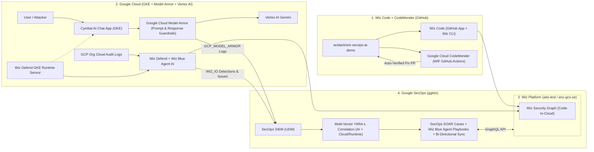

# Wiz + Google SecOps + Model Armor + CodeMender — End-to-End Security Demo

> **⚠️ SANDBOX DEMO REPOSITORY ONLY:** This repository intentionally contains realistic security vulnerabilities (OS Command Injection `CWE-78`, Path Traversal `CWE-22`, SQL Injection `CWE-89`, and permissive Kubernetes/Dockerfile IaC defaults) strictly for demonstrating **Wiz Code**, **Wiz Defend**, **Google Cloud Model Armor**, **Google SecOps**, and **Google Cloud CodeMender** in an isolated lab environment. **Never deploy this application to production.**

## Unified Demo Architecture ("Code → AI → Cloud/Runtime → SOC → Auto-Fix")

## Demo Attack Vectors
1. **AI Prompt Attack (Model Armor → SecOps):** Send a prompt injection, PII exfiltration, or malicious URI in the AI Chat UI → blocked in real time by **Model Armor** (`wiz_demo_model_armor`) and logged to **Google SecOps** (`GCP_MODEL_ARMOR`).
2. **Runtime Exploit (Wiz Defend GKE Sensor → Blue Agent → SecOps):** Exploit the intentional `/api/diagnostics/ping` (`CWE-78`) command injection endpoint on the live GKE pod → **Wiz Runtime Sensor** detects suspicious runtime execution, **Wiz Blue Agent** builds the attack narrative, and the alert streams into **SecOps** (`WIZ_IO`) to correlate with the AI attack.
3. **Cloud Control-Plane Attack (Wiz Defend GCP Audit Logs → SecOps):** Create a suspicious cloud resource (e.g. firewall rule with `pentest` in the name) → caught by **Wiz Defend Cloud Events** and synced bidirectionally with **SecOps**.
4. **Autonomous Code Remediation (Wiz Code + CodeMender):** **Wiz Code** maps the code repo + IaC flaws directly to the running GKE pod; **CodeMender** (`codemender-scan.yml` & `codemender-remediate.yml`) finds, verifies, and opens an automated fix Pull Request in GitHub.
